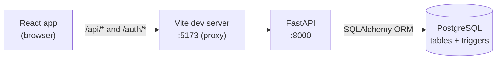

# LogiTrack: Logistics and Fleet Management System

LogiTrack is a full-stack web application for running a small logistics operation end to end:
- customers order products from an online shop;
- stock is reserved from warehouses;
- paid orders become shipments with an assigned driver and vehicle;
- shipments are tracked to delivery.

It is built with **React + Tailwind CSS** on the frontend, **FastAPI + SQLAlchemy** on the backend and
**PostgreSQL** as the database. Important business rules, such as stock limits, one active shipment per order and
valid status transitions, are enforced in the database as well as in the API.

> This README is the overview. Detailed documentation is in [`docs/`](docs):
> [Setup](docs/SETUP.md) · [Architecture](docs/ARCHITECTURE.md) · [API](docs/API_DOCUMENTATION.md) ·
> [Database schema](docs/DATABASE_SCHEMA.md) · [ER diagram](docs/ER_DIAGRAM.md) · [Testing](docs/TESTING.md) ·
> [Fulfilment workflow](docs/FULFILMENT_WORKFLOW.md)

---

## Problem statement and objectives

Small logistics businesses often track orders, stock, vehicles, drivers and deliveries in separate spreadsheets.
The records drift apart: stock is oversold, an order is shipped twice, or a parcel shows "delivered" in one place
and "pending" in another.

LogiTrack's objectives are to:

1. **Keep a single, consistent record** of orders, inventory, shipments and deliveries in one relational database.
2. **Prevent invalid states at the database level.** This means no negative stock, at most one active shipment per
   order, no status moving backwards, and no changes after delivery.
3. **Automate fulfilment.** A paid order becomes a shipment from the right warehouse, on a matching route, with
   an eligible driver.
4. **Give each role the view it needs**: customers, drivers, operations managers and administrators.
5. **Serve as a DBMS case study**: normalised schema, constraints, indexes, triggers and stored functions, with
   transactions and row locking for concurrency.

## Features

Everything listed here is implemented and reachable from the API. "UI" marks features that also have a page in
the frontend.

| Area | Implemented |
|---|---|
| Accounts | Customer self-registration; JWT sign-in (60-minute tokens); role-based access; editable profile with password change (UI). |
| Shop | Product catalogue with live stock across all warehouses; search, category filter and sort; cart; checkout with an address (UI). |
| Inventory reservation | Checkout locks stock rows, deducts stock from warehouses in order, and records exactly which warehouse supplied each product, in one transaction. |
| Payments | **Development-only payment simulator** (success or failure; no real provider) (UI); manual payment records and status updates (API). |
| Fulfilment | On successful payment: one shipment from the warehouse that supplied the most units, a route matched to the delivery city, shipment items, a first tracking event, and automatic driver and vehicle assignment when an eligible driver exists. |
| Tracking and delivery | Status timeline (UI); forward-only shipment statuses; delivered and cancelled shipments are locked; failed delivery attempt and retry; delivery status kept consistent with the shipment. |
| Fleet | Vehicles, drivers (with licence expiry), driver–vehicle assignments, maintenance records (UI for vehicles and drivers; API for the rest). |
| Operations | Orders, shipments, deliveries, invoices and payments lists (UI); manual shipment creation and driver assignment (API). |
| Analytics | Dashboard metrics; orders and shipments by status; revenue; top products; low stock; delivery success rate; driver performance; delayed shipments; stock value per warehouse (UI + API). |
| Administration | Users list (UI); create users, roles and employees (API). |

### User roles

| Role | What they can do (enforced by the API) |
|---|---|
| **CUSTOMER** | Shop, check out, simulate payments, and view their own orders, shipments, deliveries, invoices and payments. |
| **DRIVER** | View assigned deliveries and shipments, record tracking updates and delivery outcomes for their own deliveries, and update their own availability. |
| **OPERATIONS_MANAGER** | Manage orders, inventory, warehouses, products, routes, vehicles, drivers, shipments and deliveries; view analytics. |
| **ADMIN** | Everything an operations manager can do, plus users, roles and employees. |

## Technology stack

| Layer | Technology |
|---|---|
| Frontend | React 19, Vite 8, Tailwind CSS 4 (`frontend/package.json`) |
| Backend | Python 3.13, FastAPI 0.141, Uvicorn, Pydantic 2, SQLAlchemy 2.0, psycopg2 |
| Auth | PyJWT (HS256), pwdlib with Argon2 password hashing |
| Database | PostgreSQL 18 (schema dump from 18.6): constraints, partial unique index, PL/pgSQL triggers and functions |
| Testing | pytest + FastAPI TestClient (backend); Node's built-in `node:test` (frontend) |

## Architecture



- The React app calls the API through the Vite proxy using a Bearer token.
- FastAPI validates the request with Pydantic, checks the role, runs the business logic and commits in one
  transaction per request.
- PostgreSQL triggers enforce the shipment and delivery rules even for direct SQL.

Full details: [docs/ARCHITECTURE.md](docs/ARCHITECTURE.md).

### Key modules

| Module | Responsibility |
|---|---|
| `backend/main.py` | All 100 API routes (counted from the registered app), request models, checkout, payment simulation and status rules. |
| `backend/fulfilment.py` | Stock allocation, planning, approval and dispatch, driver/vehicle allocation, cancellation, stock recovery. |
| `backend/operations.py` | Read-only operations views: order journey, warehouses, summary, shipment desk. |
| `backend/seed_demo_data.py` | Optional development demo fleet and warehouse stock (idempotent, insert-only). |
| `backend/models.py` | SQLAlchemy models for the 24 tables. |
| `backend/database.py` | Engine and per-request session (`DATABASE_URL`). |
| `backend/auth.py`, `backend/jwt_utils.py` | Password hashing; JWT creation and validation (`JWT_SECRET_KEY`). |
| `backend/seed_shop_products.py` | Adds three demo products for the shop. |
| `backend/set_demo_passwords.py` | Gives the seeded accounts a password you choose (the seed contains no usable passwords). |
| `database/schema.sql`, `database/seed.sql` | Base schema and sample data. |
| `database/migrations/00*.sql` | Inventory reservations (001), one active shipment per order (002), status rules (003), shipment items tied to their shipment's order (004), order fulfilment planning (005), Operations approval and demo-seed ledger (006), optional shipment route (007). |
| `frontend/src/components/` | Pages (Dashboard, Shop, Orders, Shipments, Tracking, Deliveries, Vehicles, Drivers, Payments, Invoices, Analytics, Users, Profile) and the shared UI kit. |
| `frontend/src/services/` | API client and authentication. |

## Project structure

```text
LogiTrack/
├── backend/
│   ├── main.py                 # FastAPI app: routes + business logic
│   ├── models.py               # SQLAlchemy models
│   ├── database.py             # engine/session from DATABASE_URL
│   ├── auth.py, jwt_utils.py   # password hashing, JWT
│   ├── seed_shop_products.py   # demo products for the shop
│   ├── set_demo_passwords.py   # set a password on the seeded accounts
│   ├── requirements.txt        # runtime dependencies (pinned)
│   ├── requirements-dev.txt    # + test dependencies (pytest, httpx)
│   ├── .env.example            # environment template (copy to .env)
│   └── tests/                  # pytest integration tests (186)
├── database/
│   ├── schema.sql              # base schema (pg_dump)
│   ├── seed.sql                # sample data
│   └── migrations/             # 001–007, applied in order
├── frontend/
│   ├── index.html, vite.config.js, package.json
│   ├── public/images/products/ # product photos
│   └── src/
│       ├── components/         # pages + UI kit
│       ├── lib/                # formatting, status rules (+ unit tests)
│       └── services/           # API client, auth
└── docs/                       # this project's documentation
```

## Getting started (Windows)

The complete, verified walkthrough with explanations is in **[docs/SETUP.md](docs/SETUP.md)**. In short:

**Prerequisites:** Git, Python 3.10+ (verified with 3.13), Node.js (verified with 24), PostgreSQL 18 with `psql`.

```powershell
# 1. Clone
git clone https://github.com/tathwaykumar/LogiTrack.git
cd LogiTrack

# 2. Database
psql -U postgres -c "CREATE DATABASE logitrack_db;"

# 3. Backend environment: edit DATABASE_URL and JWT_SECRET_KEY after copying
Copy-Item backend\.env.example backend\.env

# 4. Backend dependencies
cd backend
python -m venv venv
.\venv\Scripts\Activate.ps1
python -m pip install -r requirements-dev.txt     # runtime + test packages (use requirements.txt for runtime only)
cd ..

# 5. Schema, sample data and migrations: this order (seed.sql also advances the ID sequences)
psql -U postgres -d logitrack_db -f database/schema.sql
psql -U postgres -d logitrack_db -f database/seed.sql
psql -U postgres -d logitrack_db -f database/migrations/001_order_inventory_reservation.sql
psql -U postgres -d logitrack_db -f database/migrations/002_shipment_one_active_per_order.sql
psql -U postgres -d logitrack_db -f database/migrations/003_status_transition_rules.sql
psql -U postgres -d logitrack_db -f database/migrations/004_shipment_item_same_order.sql
psql -U postgres -d logitrack_db -f database/migrations/005_order_fulfilment_planning.sql
psql -U postgres -d logitrack_db -f database/migrations/006_operations_approval_and_demo_ledger.sql
psql -U postgres -d logitrack_db -f database/migrations/007_shipment_route_optional.sql

# 6. Demo shop products + a password for the seeded accounts (prompts; input hidden)
cd backend
python seed_shop_products.py
python set_demo_passwords.py
cd ..

# 7. Frontend dependencies
cd frontend; npm install; cd ..
```

> **Seeded accounts have no password until you set one.** `seed.sql` deliberately contains no passwords; step 6's
> `set_demo_passwords.py` sets one you choose for `admin01`, `manager01`, `driver01`, `driver02`, `customer01` and
> `customer02`. Customers can also self-register from the sign-up page.

### Environment variables

| Variable | File | Purpose |
|---|---|---|
| `DATABASE_URL` | `backend/.env` | SQLAlchemy URL, for example `postgresql+psycopg2://<user>:<password>@localhost:5432/logitrack_db` |
| `JWT_SECRET_KEY` | `backend/.env` | Secret used to sign JWTs. Use a long random value. |
| `TEST_DATABASE_URL` | environment (optional) | Overrides the test database; the name must end in `_test`. |

`backend/.env` is git-ignored. Only `backend/.env.example`, which contains placeholders, is committed.

### Run

Use two terminals:

```powershell
# Terminal 1: backend (must start inside backend/)
cd backend
.\venv\Scripts\Activate.ps1
uvicorn main:app --reload

# Terminal 2: frontend
cd frontend
npm run dev
```

| URL | What |
|---|---|
| http://localhost:5173 | Web application |
| http://127.0.0.1:8000 | API (`GET /` returns a health message) |
| http://127.0.0.1:8000/docs | Interactive API documentation (Swagger UI) |
| http://127.0.0.1:8000/openapi.json | OpenAPI schema |

The frontend proxy expects the API on port **8000**.

## Tests

```powershell
cd backend; .\venv\Scripts\Activate.ps1; python -m pytest tests -q; cd ..
cd frontend; node --test src/lib/status.test.js; npm run build; cd ..
```

- The backend tests create and drop their own `logitrack_test` database (your role needs `CREATEDB`); your
  data is not touched.
- Last observed result: **186 backend tests passed** and **6 frontend tests passed**.
- Coverage and gaps: [docs/TESTING.md](docs/TESTING.md).

## Troubleshooting (most common)

| Problem | Fix |
|---|---|
| Seeded users get 401 at login | Run `python set_demo_passwords.py` in `backend/` ([SETUP.md step 8](docs/SETUP.md#8-give-the-seeded-accounts-a-password)). |
| `ModuleNotFoundError: No module named 'auth'` | Start uvicorn from inside `backend/`. |
| `Activate.ps1` is blocked | `Set-ExecutionPolicy -Scope CurrentUser RemoteSigned` |
| Frontend loads but every request fails | The backend must be running on port 8000. |

More: [docs/SETUP.md#troubleshooting](docs/SETUP.md#troubleshooting).

## Current limitations

These are true of the current code:

- **No real payment processing.** Payments are simulated (development only) or entered manually.
- **Reservation means deduction.** Checkout deducts stock immediately. An unpaid order can be cancelled (or
  released by operations when abandoned) and its stock is returned exactly once. Releasing abandoned orders is a
  manual action, not a scheduled job.
- **Older orders predate several rules.** Orders from before migrations 005–007 have no fulfilment plan or approval record
  and, in the development data, some disagree with their shipments. They are reported (`GET /operations/summary`), not
  rewritten.
- **Routes are optional.** A route is attached only when exactly one active route matches; otherwise the shipment has
  no route and no estimated delivery. Routes never block fulfilment.
- **API validation is thin.** Status fields in the `/…/status` endpoints are free text, and the generic create
  and update endpoints rely on database constraints: a rule violation is reported as a 4xx naming the violated
  rule, but with a generic message rather than a field-by-field explanation.
- **Setup.** Migrations are plain SQL files applied by hand, with no tracking table, so you must remember which
  have run (each is safe to re-run).
- **Auth.** Tokens cannot be revoked; deactivating a user or changing their role takes effect only when their token
  expires (60 minutes).
- **Frontend.** No URL routing (pages are switched in memory). The UI supports only the four seeded roles. There is
  no production hosting configuration: the app runs through the Vite dev server.
- **Tests.** No frontend component or end-to-end tests, no CI, and the analytics endpoints and most generic CRUD
  endpoints still have little or no direct test coverage.

## Possible future improvements (not implemented)

These are proposals, not features of the current code:

- Validate status values in the API (an allow-list per endpoint) with field-level error messages.
- Release reserved stock on cancellation or payment timeout; add order cancellation; sync order status with shipment
  progress.
- Model routes against warehouses and structured addresses (city or postal code) instead of free text.
- Integrate a real payment gateway (sandbox) behind the existing payment flow.
- Adopt a migration tool (for example Alembic) with version tracking.
- Add URL routing, frontend component tests, and a CI pipeline.
- Add token refresh and revocation, and re-check `is_active` on each request.
