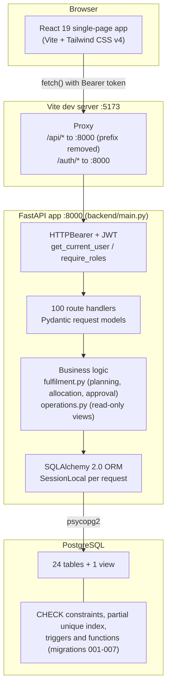
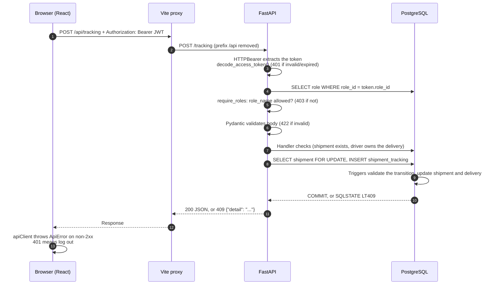
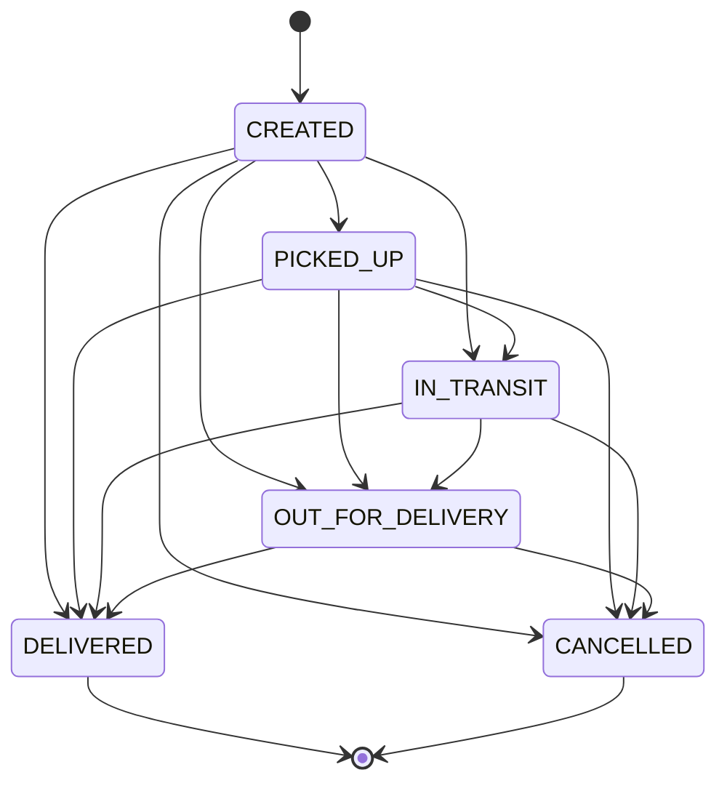

# Architecture

This document describes how LogiTrack is built and how a request moves through it. It covers only what the code
in this repository implements. File references point to the actual source.

Related documents: [API_DOCUMENTATION.md](API_DOCUMENTATION.md) · [DATABASE_SCHEMA.md](DATABASE_SCHEMA.md) ·
[ER_DIAGRAM.md](ER_DIAGRAM.md)

## Contents

1. [System overview](#1-system-overview)
2. [Layers](#2-layers)
3. [Request and response flow](#3-request-and-response-flow)
4. [Authentication and authorisation](#4-authentication-and-authorisation)
5. [Business workflows](#5-business-workflows)
6. [Transactions, concurrency and error handling](#6-transactions-concurrency-and-error-handling)
7. [External dependencies and integration points](#7-external-dependencies-and-integration-points)
8. [Frontend structure](#8-frontend-structure)

---

## 1. System overview

LogiTrack is a three-tier web application:



- The browser only ever talks to the Vite dev server. `frontend/vite.config.js` proxies `/api/*` to
  `http://127.0.0.1:8000` (stripping the `/api` prefix) and `/auth/*` to the same address unchanged.
- The backend does **not** configure CORS and does **not** serve the built frontend (`frontend/dist`). The
  supported way to run the app is the Vite dev server plus the API. A production deployment layout is not defined
  in the repository.
- The API documentation UI generated by FastAPI is available at `http://127.0.0.1:8000/docs`, and the raw schema
  at `/openapi.json`. Both were verified.

## 2. Layers

| Layer | Location | Responsibility |
|---|---|---|
| Presentation | `frontend/src/components/*.jsx` | Pages per role, forms, tables, charts. State is local React state; there is no router or global store. |
| API client | `frontend/src/services/apiClient.js`, `authService.js` | `fetch` wrappers that add the Bearer token, turn non-2xx responses into `ApiError(message, status)`, and log in/register. |
| HTTP / API | `backend/main.py` | FastAPI app (`app = FastAPI(title="LogiTrack API")`), Pydantic request models, route handlers, dependency injection. |
| Auth | `backend/jwt_utils.py`, `backend/auth.py`, `main.py` (`get_current_user`, `require_roles`) | JWT creation and validation (HS256, 60 minutes); Argon2 password hashing via `pwdlib`; role checks. |
| Business logic | `backend/fulfilment.py` (stock allocation, planning, approval and dispatch, driver/vehicle evaluation and allocation, cancellation, stock recovery), `backend/main.py` (checkout, payment simulation, `record_tracking_event`, status transitions) | The rules that decide what happens to an order. `fulfilment.py` takes a session and never commits; the route handlers own the transaction. |
| Operations views | `backend/operations.py` | Read-only: the order journey (`order_tracking_view`) in staff, driver and customer versions, the warehouse overview, the operations summary, the shipment desk and the assignment options. Nothing here writes. |
| Data access | `backend/models.py`, `backend/database.py` | SQLAlchemy declarative models; engine from `DATABASE_URL`; `get_db()` yields one session per request and closes it afterwards. |
| Database | PostgreSQL; `database/schema.sql`, `database/migrations/*.sql` | Tables, keys, CHECK constraints, a partial unique index, triggers and functions that enforce business rules independently of the API. |

The backend's Python modules are `main.py` (routes), `fulfilment.py`, `operations.py`, `models.py`, `database.py`, `auth.py`, `jwt_utils.py` and the stand-alone scripts `seed_demo_data.py` and `set_demo_passwords.py`. Imports are relative to the `backend/` folder (`from auth import …`), so the
server must be started from inside `backend/`.

## 3. Request and response flow

A typical authenticated request, here `POST /tracking` by a driver:



Responses are plain JSON dictionaries built in each handler. No `response_model` is declared, so OpenAPI shows
response bodies as untyped. Errors raised with `HTTPException` produce `{"detail": "..."}`. Pydantic validation
errors produce FastAPI's standard 422 body.

## 4. Authentication and authorisation

**Login** (`POST /auth/login`):
1. The user is looked up by `username`. If none exists, the API returns 401. If `is_active` is false, it returns 403.
2. The password is checked with Argon2 (`pwdlib.PasswordHash.recommended()`). A stored value that is not a valid
   hash (such as the placeholders in `seed.sql`) counts as a wrong password and returns 401.
3. On success the API issues a JWT signed with `JWT_SECRET_KEY` (HS256) containing `user_id`, `username`,
   `role_id` and `exp` (60 minutes).

**Each protected request:**
- `HTTPBearer` requires an `Authorization: Bearer <token>` header. A missing header gives 401 `"Not authenticated"`;
  an invalid or expired token gives 401 `"Invalid or expired token"`.
- `get_current_user` decodes the token only; it does **not** reload the user. A deactivated user therefore keeps
  access until the token expires.
- `require_roles(*names)` loads the `role` row for the token's `role_id` and compares `role_name` with the allowed
  names (403 otherwise). Changing a user's role takes effect only after they get a new token.
- Endpoints that use `get_current_user` alone (for example `GET /shipments`, `GET /orders/{order_id}`) do their own
  checks inside the handler. Customers are limited to their own records, and drivers in some endpoints to the
  shipments they are assigned. Exact rules per endpoint are in [API_DOCUMENTATION.md](API_DOCUMENTATION.md).

**Registration** (`POST /auth/register`) always creates a `users` row with the `CUSTOMER` role plus a `customer`
row. Staff accounts can only be created by an ADMIN (`POST /users`, then `POST /employees`, then `POST /drivers`).

**Frontend.**
- `authService.login` stores `{ accessToken, tokenType, user: { id, username, roleId } }` in `localStorage` under
  the key `logitrack.auth`.
- `App.jsx` accepts a stored session only if `roleId` is 1–4.
- The visible navigation is chosen by **numeric** `roleId` in `AppShell.jsx`
  (1 ADMIN, 2 OPERATIONS_MANAGER, 3 DRIVER, 4 CUSTOMER), whereas the backend checks role **names**. The two agree
  only while role ids match the seed data.
- Hiding pages in the UI is cosmetic; the backend enforces access on every call. Any 401 makes the page log the
  user out.

## 5. Business workflows

### 5.1 Customer shop: checkout and inventory reservation

`POST /shop/checkout` (CUSTOMER), one database transaction:

1. Validate the body: 1–50 items, quantity 1–10,000, a non-blank delivery address (and an optional free-text city). Duplicate product lines are summed.
2. `allocate_stock()` (`backend/fulfilment.py`): for each product, in ascending `product_id` order, lock the product row and its inventory rows that
   have stock in **ACTIVE** warehouses (`SELECT … FOR UPDATE`). If total stock is short, return 409 `"Insufficient stock for …"`.
3. Choose where stock comes from using stock alone, never routes: one warehouse that holds every item (the lowest id if several do), otherwise several
   warehouses in id order, with the shipment originating at the one supplying the most units and a note saying transfers are not modelled.
4. Insert `orders` (`PENDING`), then each `order_item` (price copied from `product.unit_price`). Deduct each allocation from `inventory.quantity` and insert
   one `order_inventory_reservation` row per warehouse used.
5. Compute the total with the database function `calculate_order_total()`, insert an `invoice` (`ISSUED`, tax 0).
6. `plan_order()` writes the fulfilment plan (`order_fulfilment`): the origin warehouse and why. If exactly one active route matches the origin and the
   order's city, it is recorded as informational; otherwise the plan simply has no route. Commit.

Any failure rolls back the order, the stock deductions, the reservations and the plan together. An unpaid order can be cancelled
(`POST /orders/{id}/cancel`) or abandoned (`POST /operations/release-abandoned`); either returns its reserved stock exactly once.

### 5.2 Payment, approval, shipment and assignment

The required sequence is **customer places order → customer pays → Operations Manager approves → shipment is created → driver and vehicle are
assigned → tracking**. Payment never dispatches anything.

`POST /shop/payments/simulate` (CUSTOMER) records a test result. It **never contacts a payment provider**; the payment method is stored as
`SIMULATED_TEST_MODE` and responses carry `"mode": "DEVELOPMENT_ONLY_SIMULATION"`.

```mermaid
sequenceDiagram
    autonumber
    participant C as Customer
    participant A as API
    participant M as Operations Manager
    participant D as Database
    C->>A: POST /shop/payments/simulate {order_id, outcome}
    A->>D: Lock order (must belong to this customer), invoice, payment
    alt payment already SUCCESS
        A-->>C: 200 already_processed=true (no writes)
    else outcome FAILED
        A->>D: payment FAILED, invoice stays ISSUED, order stays PENDING
        A-->>C: 200 fulfilment=null
    else outcome SUCCESS (order must be PENDING)
        A->>D: payment SUCCESS, order CONFIRMED, invoice PAID, PAID logged
        A-->>C: 200 fulfilment.status = AWAITING_APPROVAL (no shipment yet)
    end
    Note over C,M: The order now waits in the operations desk (stage "awaiting approval").
    M->>A: POST /operations/orders/{id}/approve
    A->>D: Lock order. Refuse unless paid, uncancelled and stock is reserved
    A->>D: Record approved_at / approved_by_user_id (first time only)
    A->>D: Re-plan warehouse; create ONE shipment, shipment_items, CREATED tracking event
    A->>D: Allocate eligible driver and vehicle (advisory lock + row locks)
    alt a pair is eligible
        A->>D: delivery (PENDING, vehicle_id, assigned_at); order PROCESSING
        A-->>M: DRIVER_ASSIGNED
    else nobody eligible
        A-->>M: PENDING_ASSIGNMENT with the reason; shipment stays CREATED, no delivery row
    end
    A->>D: COMMIT (approval, shipment and assignment together)
```

`approve_paid_order()` then `fulfil_paid_order()` (`backend/fulfilment.py`) create **at most one** shipment:

| Step | Rule | If it fails |
|---|---|---|
| Payment | The order must have a `SUCCESS` payment and not be cancelled. | 409; nothing is recorded. |
| Reservations | Active reservations must exist and add up exactly to the order quantities. | 409 `No stock is reserved…` (missing) or `RESERVATION_INCOMPLETE` (mismatch): no shipment. Staff can use `recover-reservation` for a paid order that predates reservations. |
| Existing shipment | If the order already has a non-cancelled shipment, report it and create nothing. | |
| Origin warehouse | The warehouse that supplied the most reserved units (ties: lowest id); it must be ACTIVE. | `WAREHOUSE_UNAVAILABLE`: no shipment; the plan is `BLOCKED` with the reason. |
| Route | **Not required.** If exactly one `ACTIVE` route runs from the origin city to the order's city it is stored and its configured duration gives the estimated delivery. Otherwise `shipment.route_id` is `NULL` and there is no estimate. | Never blocks. |
| Shipment | Insert `shipment` (`CREATED`), one `shipment_item` per order line, and a `CREATED` tracking event. | |
| Driver and vehicle | `find_eligible_driver()` (below). If found: insert `delivery` (`PENDING`) with `vehicle_id` and `assigned_at`; order becomes `PROCESSING`. | `PENDING_ASSIGNMENT`: shipment kept with no delivery; the plan becomes `AWAITING_ASSIGNMENT` with the reason. |

A driver and vehicle pair is eligible when all of the following hold (`evaluate_fleet()`); each rejected pair carries its reasons, which the operations
desk shows. Among eligible pairs the least-loaded driver is chosen (ties: lowest ids). Candidate rows are locked and re-checked before use, under one
PostgreSQL advisory lock (key `7340001`), so two simultaneous approvals cannot claim the same driver or vehicle.
- `driver.availability_status = 'AVAILABLE'` and `license_expiry >= today`.
- `employee.employment_status = 'ACTIVE'`, and the linked user (if any) is active.
- The driver has a current `driver_vehicle_assignment` whose vehicle has status `ACTIVE` or `AVAILABLE`, and that vehicle is not currently assigned to a different driver.
- The driver has fewer than `MAX_OPEN_DELIVERIES_PER_DRIVER` open deliveries (default 3; `PENDING`, `OUT_FOR_DELIVERY`, `FAILED`).
- The vehicle's free capacity (capacity minus the weight of its open deliveries) covers the shipment. If a product has no weight the check is skipped and the response says so.

Operations staff can assign or reassign by hand (`POST /shipments/{id}/assignment`, validated by the same rules and listing why each other pair
cannot be chosen), re-check (`POST /operations/orders/{id}/retry-fulfilment`) or retry the older automatic path
(`POST /shipments/{id}/assign-driver`). `POST /shipments` can still create a shipment by hand, but applies the same payment check and records the approval.

**Stock recovery.** `POST /operations/orders/{id}/recover-reservation` reserves stock for a *paid* order that predates reservations. It needs an explicit
confirmation that the stock was not already deducted, runs in one transaction under row locks, is idempotent, and never approves the order or creates a
shipment.

**What each audience sees.** `operations.order_tracking_view()` builds one journey from stored rows and trims it per audience. Customers get a plain-language
stage (*Awaiting payment*, *Awaiting approval*, *Preparing shipment*, *Driver assigned*, …) and see a driver and vehicle only when a real `delivery` row exists;
allocation diagnostics, blocked reasons, warehouse names and the internal planning milestone are staff-only. A shipment that predates approvals is shown to
staff as `not_recorded` and to customers without any approval step; no approval is ever invented.

### 5.3 Tracking and delivery status

The shipment status is the source of truth and moves only through tracking events:



An event with the *current* status is also allowed, as a location checkpoint while the shipment is open.

Three endpoints change status, and all go through `record_tracking_event()`, which locks the shipment row and
checks `shipment_transition_error()`:
- `POST /tracking`: ADMIN, OPERATIONS_MANAGER, or the DRIVER assigned to the shipment.
- `PUT /shipments/{id}/status`: ADMIN, OPERATIONS_MANAGER. Sending the current status returns 200 and creates no event.
- `PUT /deliveries/{id}/status`: ADMIN, OPERATIONS_MANAGER, or the assigned DRIVER.
  - `OUT_FOR_DELIVERY`, `DELIVERED` and `CANCELLED` are recorded as tracking events.
  - `FAILED` is a delivery-only state, allowed only while the shipment is `OUT_FOR_DELIVERY`.
  - Moving back to `PENDING` returns 409.

The database repeats every check in triggers (migration 003), so direct SQL and the stored procedure follow the
same rules. Violations become HTTP 409. The delivery status is kept in step automatically
(see [DATABASE_SCHEMA.md §5.3](DATABASE_SCHEMA.md#53-shipment-and-delivery-status-rules-migration-003)).

### 5.4 Administrative CRUD

Most remaining endpoints are thin create, list and update-status operations, for example on products, warehouses,
inventory, vehicles, assignments, maintenance, routes, employees, payments and invoices. They write what they
receive. Validation comes from Pydantic types and the database's constraints, with no extra business rules (see §6).

## 6. Transactions, concurrency and error handling

**Transaction boundary.** One SQLAlchemy session per request (`database.get_db`), with `autocommit=False`. Each
handler calls `db.commit()` itself, and the session is closed after the response. Multi-step operations (checkout,
payment and fulfilment, status changes) commit once at the end, so they are all-or-nothing.

**Locking.** All of these use `SELECT … FOR UPDATE`:

| Operation | Rows locked, in order |
|---|---|
| Checkout | product, then inventory, ordered by id. |
| Payment simulation | order, invoice, payment. Nothing is dispatched. |
| Approval (`/approve`, `/retry-fulfilment`) | order, then (advisory lock `7340001`) driver and vehicle candidates, then the shipment. |
| Stock recovery, cancellation, abandoned release | order, then the stock rows (`FOR UPDATE`). Exactly-once release is enforced by `released_at`. |
| `POST /shipments` | The order first (the same order as approval), which avoids a deadlock between the two. |
| Status changes | The shipment row. The tracking trigger also locks it. |

The concurrency cases are covered by tests ([TESTING.md](TESTING.md)).

**Error handling as implemented.** The behaviour differs between endpoints:

| Situation | Behaviour |
|---|---|
| Missing or invalid token | 401 |
| Wrong role / not the owner | 403 |
| Pydantic validation failure | 422 (FastAPI default body) |
| Shop, payment, fulfilment, shipment-status, tracking and delivery-status conflicts | 409 with a specific `detail` |
| Missing record in a path (for example `PUT /orders/{id}/status`, `GET /customers/{id}`) | 404 `{"detail": "... not found"}` |
| Duplicate value (unique constraint) | 409 naming the violated rule |
| Bad foreign key, CHECK failure, null in a required column, malformed value | 422 naming the violated rule (or a generic format message) |
| Trigger violation (SQLSTATE `LT409`) in status endpoints | 409 with the trigger's message |
| Any other database error | 500 `{"detail": "A database error occurred"}`, logged server-side |

Database errors are mapped by global exception handlers in `backend/main.py` (`IntegrityError`, `DataError`,
`DBAPIError`), so the generic create and update endpoints need no per-endpoint error code. The handlers return a
fixed sentence plus the constraint name, never the SQL or the offending values.

## 7. External dependencies and integration points

| Dependency | Where | Notes |
|---|---|---|
| PostgreSQL | `DATABASE_URL` | Required. The schema dump was produced by PostgreSQL 18.6. `schema.sql` contains `\restrict` meta-commands, which need a recent `psql` (see [SETUP.md](SETUP.md#troubleshooting)). |
| Python packages | `fastapi`, `uvicorn`, `SQLAlchemy`, `psycopg2-binary`, `python-dotenv`, `PyJWT`, `pwdlib[argon2]` | Pinned in `backend/requirements.txt`; `backend/requirements-dev.txt` adds `pytest` and `httpx` for the tests. |
| npm packages | `frontend/package.json` | `react`, `react-dom`, `vite`, `@vitejs/plugin-react`, `tailwindcss`, `@tailwindcss/vite`. |
| Google Fonts | `frontend/index.html` | Loads Bricolage Grotesque, Instrument Serif and Inter from `fonts.googleapis.com`. The UI falls back to system fonts offline. |
| Payment provider | none | Payments are simulated (`/shop/payments/simulate`) or recorded manually (`POST /payments`). |
| Email, SMS, maps, file storage | none | Not implemented. |

## 8. Frontend structure

| Path | Purpose |
|---|---|
| `src/main.jsx`, `src/App.jsx` | Mounts the app; shows `LoginPage` or `AppShell` depending on the stored session. |
| `src/components/AppShell.jsx` | Sidebar navigation filtered by role, header, and page switching (React state, no URL routing). |
| `src/components/{Dashboard,Shop,Orders,Shipments,Tracking,Deliveries,Vehicles,Drivers,Payments,Invoices,Analytics,Users,Profile,Warehouses}.jsx` | One component per page. `Shipments.jsx` shows the server-driven desk (`OperationsShipments.jsx`) to staff and a scoped list to drivers and customers. |
| `src/components/OrderTracker.jsx`, `OperationsShipments.jsx` | The order journey (milestones, facts, tracking events) used on Orders, Deliveries and the shipment desk; the desk with search, filters, sorting, pagination, approval, manual assignment and stock recovery. |
| `src/components/LoginPage.jsx`, `LoginForm.jsx`, `SignupForm.jsx` | Sign-in and customer self-registration. |
| `src/components/ui.jsx`, `charts.jsx`, `ProductImage.jsx` | Shared UI kit, single-series charts, and product photos with fallback. |
| `src/lib/format.js`, `src/lib/status.js` | Formatting helpers; shared shipment and delivery status definitions (with unit tests in `status.test.js`). |
| `src/services/apiClient.js`, `authService.js` | HTTP layer. `apiClient.js` also turns error responses into friendly messages (`friendlyError`, tested in `apiClient.test.js`). |
| `public/images/products/*.webp` | 12 product photos, mapped by product name in `ProductImage.jsx`. Unknown names get a category illustration. |

Pages visible per role (from `AppShell.jsx`):

| Page | ADMIN | OPERATIONS_MANAGER | DRIVER | CUSTOMER |
|---|:-:|:-:|:-:|:-:|
| Dashboard, Shipments, Tracking, Deliveries, My profile | ✓ | ✓ | ✓ | ✓ |
| Orders, Payments, Invoices | ✓ | ✓ | | ✓ |
| Shop | | | | ✓ |
| Warehouses, Vehicles, Drivers, Analytics | ✓ | ✓ | | |
| Users | ✓ | | | |
