# Entity-Relationship Diagram

The diagram covers the 24 tables of the LogiTrack database and all 36 foreign keys (the two constraints between
`shipment` and `shipment_item`, one plain and one composite, share a single line). It was built from the
schema produced by `database/schema.sql` plus the seven migration files in `database/migrations/` (001–007), cross-checked against
`backend/models.py`. Relationships come only from declared foreign keys, never from column names.

Column-level detail (types, defaults, every constraint) is in [DATABASE_SCHEMA.md](DATABASE_SCHEMA.md).

## How to read the cardinalities

Cardinalities are derived from the constraints:

- A `NOT NULL` foreign key means the child must have exactly one parent (`||` on the parent side).
- A nullable foreign key means zero or one parent (`|o`).
- A `UNIQUE` foreign key means the parent has **at most one** child (`o|`); otherwise zero or more (`o{`).

Key markers: `PK` primary key, `FK` foreign key, `UK` unique.

## Diagram

```mermaid
erDiagram
    role ||--o{ users : "assigned to"
    users ||--o| customer : "has customer profile"
    users |o--o| employee : "has employee profile"
    employee ||--o| driver : "is a"
    employee |o--o{ warehouse : "manages"

    customer ||--o{ orders : "places"
    orders ||--o{ order_item : "contains"
    product ||--o{ order_item : "ordered as"
    orders ||--o| payment : "paid by"
    orders ||--o| invoice : "billed by"

    warehouse ||--o{ inventory : "stocks"
    product ||--o{ inventory : "stocked as"
    orders ||--o{ order_inventory_reservation : "reserves"
    order_item ||--o{ order_inventory_reservation : "sourced by"
    warehouse ||--o{ order_inventory_reservation : "supplies"
    product ||--o{ order_inventory_reservation : "reserved as"

    orders ||--o{ shipment : "fulfilled by"
    warehouse ||--o{ shipment : "origin of"
    route |o--o{ shipment : "optional route"
    shipment ||--o{ shipment_item : "carries"
    order_item ||--o{ shipment_item : "shipped as"
    shipment ||--o{ shipment_tracking : "tracked by"
    shipment ||--o| delivery : "delivered via"
    driver ||--o{ delivery : "performs"
    vehicle |o--o{ delivery : "carries"

    orders ||--o| order_fulfilment : "planned by"
    warehouse |o--o{ order_fulfilment : "planned origin"
    route |o--o{ order_fulfilment : "informational route"
    users |o--o{ order_fulfilment : "approved by"
    orders ||--o{ order_fulfilment_event : "logged in"
    shipment |o--o{ order_fulfilment_event : "concerns"
    users |o--o{ order_fulfilment_event : "acted by"

    driver ||--o{ driver_vehicle_assignment : "drives"
    vehicle ||--o{ driver_vehicle_assignment : "assigned in"
    vehicle ||--o{ vehicle_maintenance : "serviced in"

    role {
        int role_id PK
        varchar role_name UK
        varchar description
    }
    users {
        int user_id PK
        int role_id FK
        varchar username UK
        varchar email UK
        varchar password_hash
        timestamp created_at
        boolean is_active
    }
    customer {
        int customer_id PK
        int user_id FK, UK
        varchar name
        varchar phone
        varchar address
        timestamp created_at
    }
    employee {
        int employee_id PK
        int user_id FK, UK "nullable"
        varchar name
        varchar phone
        varchar department
        date hire_date
        numeric salary
        varchar employment_status
    }
    driver {
        int employee_id PK, FK
        varchar license_no UK
        date license_expiry
        varchar availability_status
    }
    product {
        int product_id PK
        varchar product_name
        varchar category
        numeric unit_price
        numeric weight
        varchar description
    }
    warehouse {
        int warehouse_id PK
        varchar warehouse_name
        varchar address
        varchar city
        numeric capacity
        int manager_employee_id FK "nullable"
        varchar status
    }
    inventory {
        int warehouse_id PK, FK
        int product_id PK, FK
        int quantity
        int reorder_level
        timestamp last_updated
    }
    orders {
        int order_id PK
        int customer_id FK
        timestamp order_date
        varchar order_status
        varchar shipping_address
        varchar destination_city
    }
    order_item {
        int order_id PK, FK
        int product_id PK, FK
        int quantity
        numeric unit_price
    }
    order_inventory_reservation {
        int reservation_id PK
        int order_id FK "UK with warehouse_id, product_id"
        int warehouse_id FK
        int product_id FK
        int reserved_quantity
        timestamp created_at
        timestamp released_at
    }
    payment {
        int payment_id PK
        int order_id FK, UK
        numeric amount
        varchar payment_method
        varchar payment_status
        timestamp payment_date
        varchar transaction_reference UK
    }
    invoice {
        int invoice_id PK
        int order_id FK, UK
        timestamp invoice_date
        numeric subtotal
        numeric tax
        numeric total_amount
        varchar invoice_status
    }
    route {
        int route_id PK
        varchar route_name
        varchar source
        varchar destination
        numeric distance_km
        interval estimated_duration
        varchar route_status
    }
    shipment {
        int shipment_id PK
        int order_id FK "partial UK: one non-cancelled per order"
        int warehouse_id FK
        int route_id FK "nullable since 007"
        timestamp shipment_date
        timestamp estimated_delivery
        timestamp actual_delivery
        varchar shipment_status
    }
    shipment_item {
        int shipment_id PK, FK
        int product_id PK, FK
        int order_id FK
        int quantity
    }
    shipment_tracking {
        int tracking_id PK
        int shipment_id FK
        varchar status
        varchar location
        timestamp tracking_timestamp
        varchar remarks
    }
    delivery {
        int delivery_id PK
        int shipment_id FK, UK
        int driver_id FK
        timestamp delivery_date
        varchar delivery_status
        varchar delivery_address
        int vehicle_id FK
        timestamp assigned_at
    }
    order_fulfilment {
        int order_id PK, FK
        varchar fulfilment_status
        varchar reason_code
        varchar reason_detail
        int origin_warehouse_id FK
        int route_id FK
        varchar route_basis
        varchar selection_note
        timestamp planned_at
        timestamp updated_at
        timestamp approved_at
        int approved_by_user_id FK
    }
    order_fulfilment_event {
        int event_id PK
        int order_id FK
        int shipment_id FK
        varchar event_type
        varchar detail
        int actor_user_id FK
        timestamp created_at
    }
    demo_seed_record {
        varchar entity PK
        varchar entity_key PK
        timestamp created_at
    }
    vehicle {
        int vehicle_id PK
        varchar registration_no UK
        varchar vehicle_type
        numeric capacity
        varchar fuel_type
        varchar status
        date purchase_date
    }
    driver_vehicle_assignment {
        int assignment_id PK
        int driver_id FK
        int vehicle_id FK
        date assigned_from
        date assigned_to
    }
    vehicle_maintenance {
        int maintenance_id PK
        int vehicle_id FK
        date maintenance_date
        varchar maintenance_type
        numeric cost
        varchar description
    }
```

Three foreign keys are **composite**, and the diagram draws each as a single line:
- `order_inventory_reservation (order_id, product_id) → order_item (order_id, product_id)`
- `shipment_item (order_id, product_id) → order_item (order_id, product_id)`
- `shipment_item (shipment_id, order_id) → shipment (shipment_id, order_id)` (migration 004). It runs along the same
  line as the plain `shipment_item.shipment_id` foreign key and makes the item's order the shipment's order.

`order_inventory_reservation` also has separate single-column foreign keys to `orders` and `product`, which
the diagram shows as well.

## Entities and relationships

### Accounts and people

- **role**: a named permission level. One role has many `users` (`users.role_id` is `NOT NULL`).
- **users**: a login account. It may have **one** `customer` profile (`customer.user_id` is `NOT NULL` and
  `UNIQUE`) and/or **one** `employee` profile (`employee.user_id` is nullable and `UNIQUE`, so an employee
  can exist without a login).
- **customer**: the profile of someone who places orders. One customer has many `orders`.
- **employee**: a staff member. It may manage many `warehouse` rows (`warehouse.manager_employee_id`, nullable)
  and may be a `driver`.
- **driver**: a subtype of employee. Its primary key `employee_id` is also the foreign key, which gives a strict
  one-to-zero-or-one "is-a" relationship. A driver performs many `delivery` rows and has many
  `driver_vehicle_assignment` rows.

### Catalogue and stock

- **product**: a sellable item.
- **warehouse**: a stock location and the origin of shipments.
- **inventory**: an **associative entity** for the many-to-many between `warehouse` and `product`. Its composite
  primary key `(warehouse_id, product_id)` means one stock row per product per warehouse.

### Orders and finance

- **orders**: a customer's order. It contains many `order_item` rows.
- **order_item**: an **associative entity** for the many-to-many between `orders` and `product`. Its composite
  primary key `(order_id, product_id)` allows each product once per order.
- **order_inventory_reservation**: an **associative entity** recording which `warehouse` supplied how many units
  of an `order_item`.
  - It references `orders`, `warehouse`, `product` and, through a composite FK, `order_item`.
  - Unique on `(order_id, warehouse_id, product_id)`.
  - Introduced by migration 001.
- **order_fulfilment** (*migration 005/006*): the fulfilment plan of an order, at most one per order. It records the origin warehouse, an optional
  informational route, the reason an order is blocked, and who approved the paid order and when. Orders placed before migration 005 have none.
- **order_fulfilment_event** (*migration 005*): the append-only log of planning, payment, approval, stock-recovery and assignment events for an order.
- **payment**: at most one per order (`payment.order_id` is `UNIQUE`).
- **invoice**: at most one per order (`invoice.order_id` is `UNIQUE`).

### Logistics

- **route**: a source/destination city pair. One route can be used by many shipments, but a shipment does not need one (*migration 007*: `shipment.route_id` is
  nullable). Source and destination are text and are **not** foreign keys to `warehouse`.
- **shipment**: the movement of an order from an origin `warehouse` along a `route`.
  - The plain FK allows many shipments per order. The partial unique index `uq_shipment_order_active`
    (migration 002) limits this to **one non-cancelled** shipment per order, which a standard ER notation
    cannot express.
- **shipment_item**: the order lines carried by a shipment. Composite PK `(shipment_id, product_id)`; composite
  FK `(order_id, product_id)` to `order_item`.
- **shipment_tracking**: the append-only event history of a shipment (many per shipment). The latest event sets
  `shipment.shipment_status` through a trigger.
- **delivery**: the last-mile assignment of a shipment to a driver and (since migration 005) a vehicle. At most one per shipment
  (`delivery.shipment_id` is `UNIQUE`); one driver has many deliveries; `vehicle_id` is nullable for older rows.

### Fleet

- **vehicle**: a fleet vehicle.
- **driver_vehicle_assignment**: an **associative entity** for the time-bounded many-to-many between `driver`
  and `vehicle` (`assigned_from`, `assigned_to`).
- **vehicle_maintenance**: maintenance history of a vehicle (many per vehicle).

### Demo data ledger

- **demo_seed_record** (*migration 006*): standalone; lists the rows added by the development demo seed. It has no foreign keys, so it is drawn without relationships.

## What the diagram cannot show

These rules are real but are expressed through indexes, CHECK constraints or triggers, not foreign keys:

| Rule | Mechanism |
|---|---|
| At most one non-cancelled shipment per order | Partial unique index `uq_shipment_order_active` |
| Delivery status must be compatible with its shipment's status | Trigger `trg_enforce_delivery_status` |
| Shipment status only moves forward; `DELIVERED`/`CANCELLED` are final | Triggers on `shipment` and `shipment_tracking` |
| `invoice.total_amount = subtotal + tax` | CHECK `chk_invoice_calculation` |
| A shipment item's order is the shipment's order | Composite foreign key `fk_shipment_item_shipment_order` (migration 004) |
| An order's status follows its shipment, forward only | Trigger `trg_sync_order_with_shipment` (migration 005) |
| One plan per order; stock released once | Primary key on `order_fulfilment.order_id`; `order_inventory_reservation.released_at` |
| Only paid orders are approved and dispatched, and only after approval | The API (`approve`, `POST /shipments`); not a database constraint |

See [DATABASE_SCHEMA.md §5](DATABASE_SCHEMA.md#5-database-enforced-business-rules).

## Discrepancies found

These are reported here rather than silently reconciled in the diagram:

1. **Resolved by migration 004:** `shipment_item.order_id` used to be unconstrained relative to `shipment.order_id`.
   The composite foreign key above now forces them to agree. The column is still redundant by design (see
   [DATABASE_SCHEMA.md §6](DATABASE_SCHEMA.md#6-design-and-normalisation)).
2. **Resolved:** `models.py` used to omit all CHECK constraints, most defaults and several indexes. It now matches the
   database and a test enforces that ([DATABASE_SCHEMA.md §7](DATABASE_SCHEMA.md#7-the-models-and-the-database)).
3. **The models declare no `relationship()` attributes.** They map columns and foreign keys only; the API writes
   joins explicitly. This does not affect the schema.
4. **The `shipment_summary` view** (in `schema.sql`) is not used by the application and is not drawn above. It joins `route`
   with an inner join, so it omits any shipment without a route (allowed since migration 007). The application does not use it.
5. **Historical data predating migrations 005–007** (checked on the development database) has no plan, no approval, and sometimes an order whose
   status lags or contradicts its shipment. These are real inconsistencies, reported by `GET /operations/summary` under `data_consistency`; the schema
   does not forbid them and no migration rewrites them.
